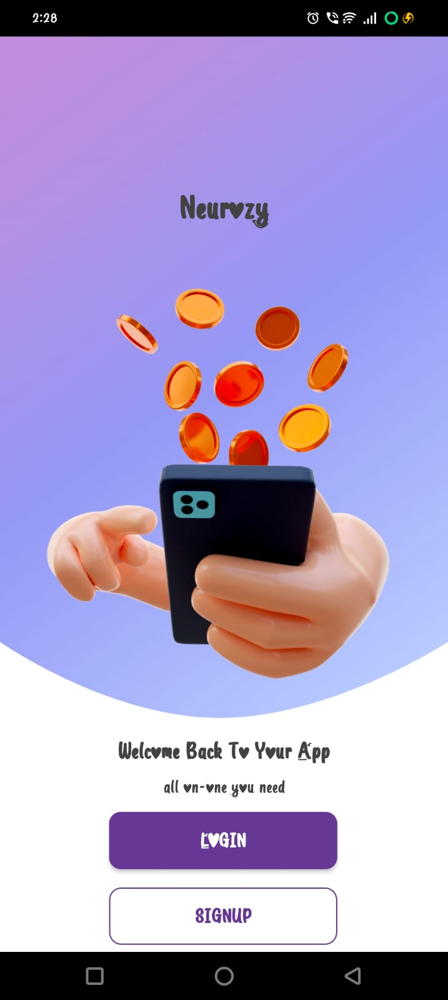
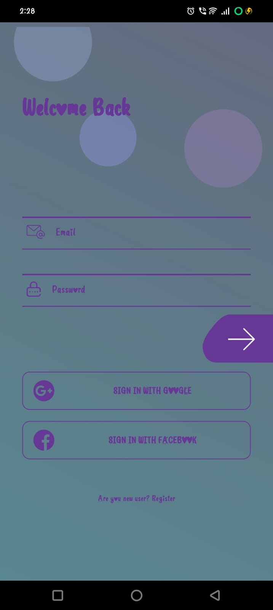
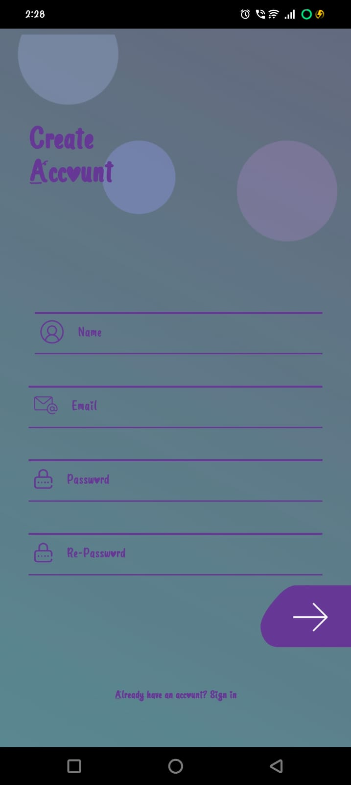

# Projectlogin# Projectlogin

A simple Android app with an Intro screen, Login screen and Signup screen. Built with Java and Android Studio. User accounts are stored locally on the device using SQLite.

## Screenshots

| Intro | Login | Signup |
|-------|-------|--------|
|  |  |  |

## Features

- Intro screen with Login and SignUp buttons
- Signup with name, email, password and re-password
- Input validation (valid email, minimum 6 characters, passwords must match)
- Duplicate email check
- Login with email and password
- Passwords stored as SHA-256 hashes (not plain text)
- Google and Facebook buttons (UI only, coming soon)

## Tech Stack

- Language: Java
- IDE: Android Studio
- Database: SQLite (`SQLiteOpenHelper`)
- UI: XML layouts (ConstraintLayout, ScrollView)

## Project Structure

```
app/src/main/java/com/example/projectlogin/
├── IntroActivity.java     # Launcher screen
├── LoginActivity.java     # Login logic
├── SignupActivity.java    # Signup logic
├── DBHelper.java          # SQLite database helper
└── MainActivity.java      # Screen shown after login

app/src/main/res/layout/
├── activity_intro.xml
├── activity_login.xml
├── activity_signup.xml
└── activity_main.xml
```

## How to Run

1. Clone the repo:
```bash
   git clone https://github.com/kumarrajjava/Projectlogin.git
```
2. Open the folder in Android Studio
3. Wait for Gradle sync to finish
4. Run on an emulator or a real device (USB debugging on)

## App Flow

Intro -> Signup -> Login -> MainActivity

## Limitations

- Accounts are saved only on the same device (no online backend)
- Google / Facebook login is not implemented yet

## Future Improvements

- Firebase Authentication for online login
- Real Google and Facebook sign-in
- Forgot password
- Show/hide password toggle
- Build the main app screen

## Author

Raj Kumar ([@kumarrajjava](https://github.com/kumarrajjava))